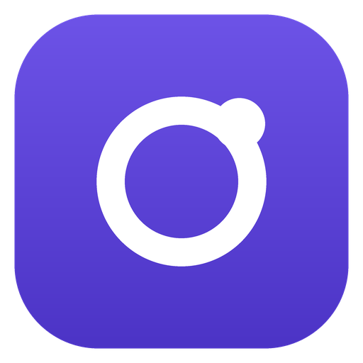
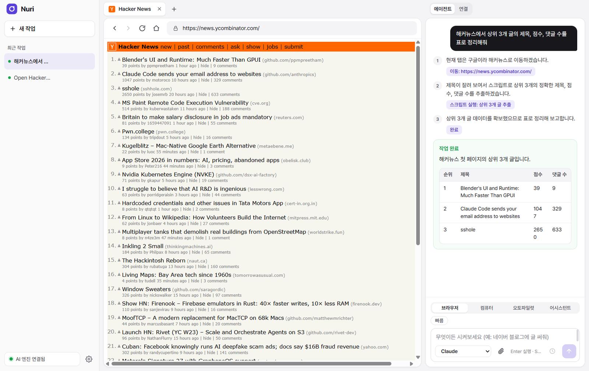
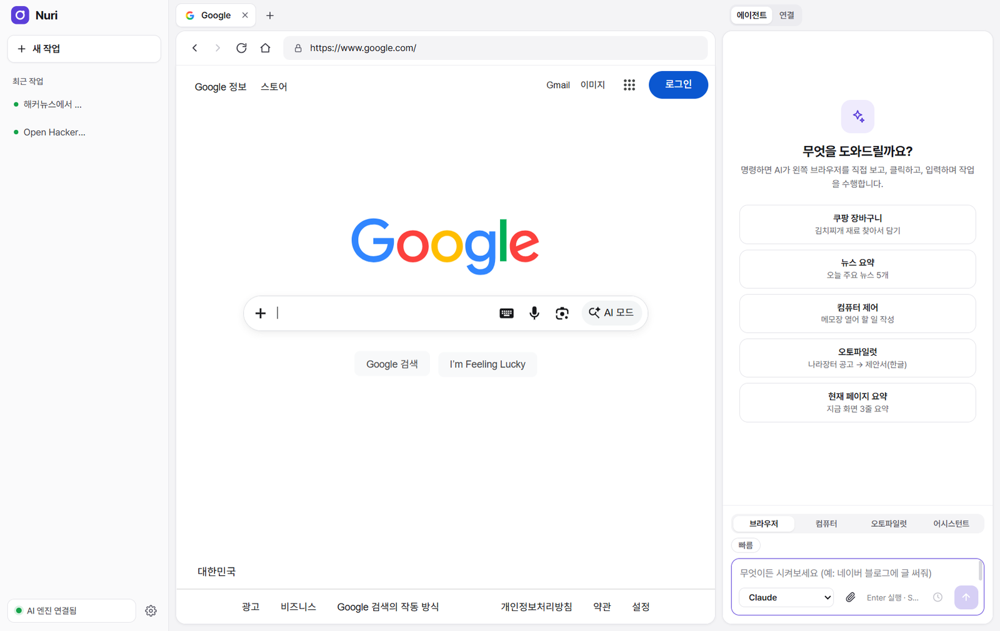
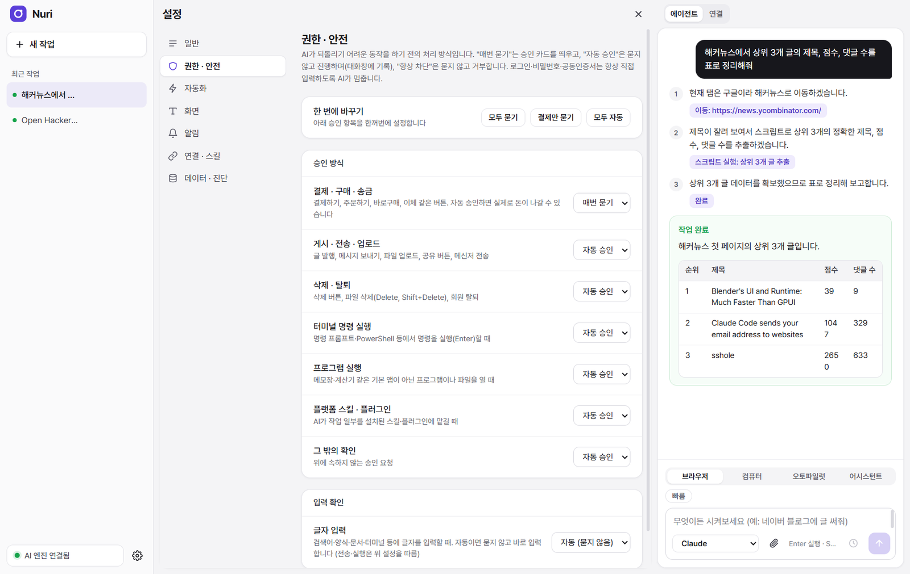
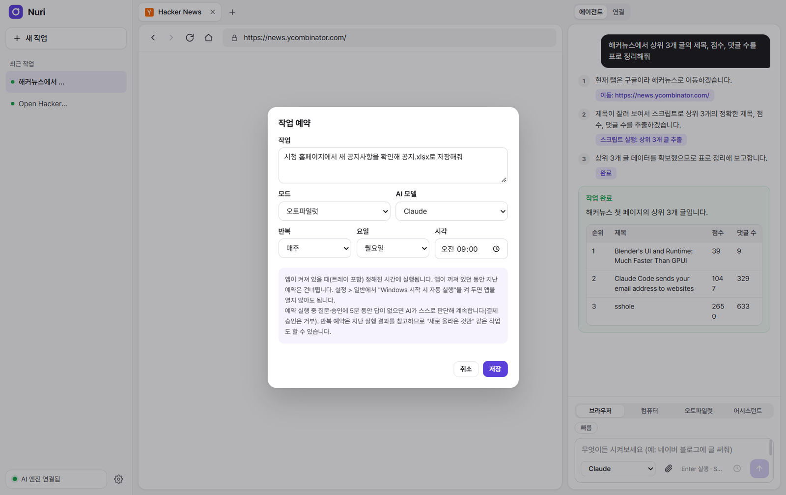
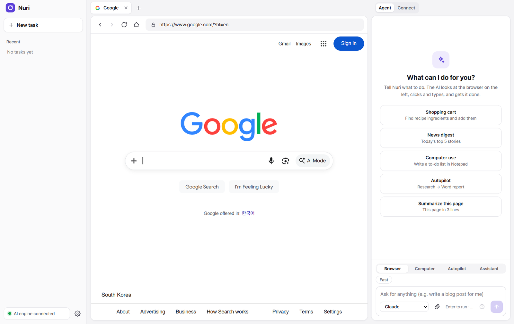

<div align="center">



# Nuri (누리)

**일을 대신 해 주는 데스크톱 AI 브라우저.**<br />
할 일을 말하면 Nuri가 페이지를 열고, 클릭하고, 입력하고, 양식을 채우고, Windows 프로그램을 다루고, 문서까지 써 줍니다. 모든 과정이 눈앞에서 한 단계씩 진행됩니다.

[English](README.md) · **한국어**

**이 포크:** Windows 원본에 macOS 14+ 실행·빌드 지원을 추가합니다. 아래 macOS 안내를 참고하세요.




</div>

## 왜 Nuri인가

- **정말로 일을 끝냅니다.** Nuri는 에이전트가 들어 있는 진짜 브라우저입니다. 에이전트가 페이지를 보고 다음 행동을 정해 직접 실행하므로, 일하는 모습을 지켜보다가 언제든 멈출 수 있습니다.
- **내가 쓰는 AI 구독 그대로.** 이미 구독 중인 공식 CLI를 씁니다: Claude(Claude Code), GPT(Codex CLI), Gemini(Antigravity CLI). 종량제 API 키는 쓰지 않습니다.
- **결정은 내가 합니다.** 결제, 게시, 전송, 삭제, 프로그램 실행을 각각 *매번 묻기*, *자동 승인*, *항상 차단* 중에서 고를 수 있습니다. 로그인, 비밀번호, 공동인증서는 항상 직접 입력합니다.
- **내 PC에서 돌아갑니다.** 로그인, 쿠키, 결과물은 내 컴퓨터에만 남습니다. AI 엔진은 `127.0.0.1`에서만 듣고, 모든 요청에 로컬 토큰이 필요합니다.

## 기능

| | |
|---|---|
| **브라우저 자동화** | 페이지의 접근성 스냅샷(iframe 포함)을 읽고 클릭, 입력, 선택, 파일 업로드를 합니다. PDF·HWP·DOCX·XLSX 첨부 파일을 읽고, 결과를 엑셀·CSV·마크다운으로 저장합니다. 읽기 어려운 화면은 스크린샷으로 봅니다. |
| **하위 에이전트** | 여러 사이트 가격 비교처럼 서로 독립된 조사는 최대 4개의 하위 에이전트가 각자 탭에서 동시에 진행합니다. |
| **스크립트** | 여러 페이지에서 수백 줄을 모으는 일 같은 대량 작업은 에이전트가 짧은 Playwright 스크립트를 써서 권한이 제한된 프로세스에서 실행합니다. |
| **컴퓨터 제어** | 엑셀, 메모장, 파일 선택 창 같은 Windows 프로그램을 마우스를 빼앗지 않고 백그라운드로 다룹니다. 필요한 앱은 화면에서 직접 조작합니다. |
| **오토파일럿** | 긴 목표를 계획으로 나눠 브라우저, PC, 문서 작성(워드·한글·PDF)까지 이어서 진행합니다. |
| **어시스턴트 모드** | 각 AI 플랫폼에 설치한 스킬, 플러그인, MCP 커넥터를 그대로 씁니다. |
| **예약 작업** | 한 번, 매일, 평일, 매주, 매월, N분마다 실행합니다. 반복 작업은 지난 결과를 참고하므로 "새로 올라온 것만" 같은 일도 됩니다. Windows와 함께 시작해 트레이에서 실행됩니다. |
| **Google 로그인** | 작은 크로미움 창에서 로그인하면 그 로그인 상태를 앱으로 가져옵니다. |
| **한국어·영어** | 앱 화면, 알림, AI 답변이 설정한 언어(설정 > 화면)를 따릅니다. |

<table>
  <tr>
    <td width="50%"><br /><sub>예시 작업이 있는 시작 화면</sub></td>
    <td width="50%"><br /><sub>권한 · 안전: 승인이 필요한 동작을 정합니다</sub></td>
  </tr>
  <tr>
    <td width="50%"><br /><sub>정해진 시간에 스스로 실행되는 예약 작업</sub></td>
    <td width="50%"><br /><sub>같은 앱의 영어 화면</sub></td>
  </tr>
</table>

## macOS에서 실행하기 (이 포크)

macOS 14 이상, Apple Silicon 또는 Intel Mac, Node.js 22 이상이 필요합니다. 이 포크는 macOS 실행 및 DMG 빌드 경로를 추가합니다. 실제 화면 제어는 Mac에서 권한을 허용한 뒤 확인해야 합니다.

```bash
xcode-select --install  # Command Line Tools가 없을 때 한 번 실행
# 설치가 끝난 뒤:
git clone https://github.com/freamwork97/Nuri_freamwork.git
cd Nuri_freamwork
npm ci
npm run build
cd apps/desktop
npm ci
npm run get-chromium
npm run build:mac-helper
npm start
```

Claude Code, Codex, agy 중 사용할 CLI를 Mac에 설치하고 먼저 터미널에서 로그인하세요. AI 엔진은 Mac에서 직접 실행되며 WSL은 필요하지 않습니다. Finder 실행 시 `~/.local/bin`, `/opt/homebrew/bin`, `/usr/local/bin`도 검색합니다. nvm 등 별도 경로의 CLI는 `npm start`로 실행하거나 해당 경로를 포함해 앱을 실행하세요.

컴퓨터 제어를 처음 사용하면 **시스템 설정 → 개인정보 보호 및 보안 → 손쉬운 사용 / 화면 및 시스템 오디오 녹음**에서 Nuri(개발 실행은 Electron 또는 터미널)에 권한을 허용하고 앱을 다시 실행하세요. macOS 도우미는 백그라운드 제어를 지원하며 Windows Sandbox와 한글 COM 자동화는 Windows 전용입니다. 로그인 시 자동 실행 설정도 현재 Windows 전용입니다.

DMG는 같은 Mac에서 `npm run dist:mac`으로 만듭니다. 먼저 `npm run get-chromium`을 실행해야 하며, 현재 Mac 아키텍처에 맞는 Chromium과 제어 도우미가 포함됩니다. Apple Silicon과 Intel 배포본은 각각 해당 아키텍처의 Mac에서 빌드하세요. 개인 개발용 서명되지 않은 빌드이며 공용 배포 시 Apple 서명과 공증을 별도로 구성해야 합니다.

설치 앱 데이터는 `~/Library/Application Support/Nuri`, 개발 실행의 작업 데이터는 저장소 `.anb-data/`에 저장됩니다. 브라우저 탭 단축키는 `⌘T`, `⌘W`입니다.

## 시작하기 (Windows)

이 저장소는 Windows 버전입니다. 앱, 컴퓨터 제어 도우미, 설치 파일 모두 Windows 전용으로 만들어집니다.

**준비물:** Windows 10 또는 11 (64비트), [Node.js](https://nodejs.org) 22 이상, 그리고 구독 계정으로 로그인한 AI CLI 하나 이상:

| 모델 | CLI | 로그인 |
|---|---|---|
| Claude | [Claude Code](https://docs.anthropic.com/en/docs/claude-code) | `claude` 실행 후 Claude 계정으로 로그인 |
| GPT | [Codex CLI](https://github.com/openai/codex) | `codex login` → ChatGPT 계정 |
| Gemini | Antigravity CLI (`agy`) | Google 계정으로 로그인 |

CLI는 Windows에 설치하거나 WSL2(Ubuntu) 안에 설치해도 됩니다. 모두 Windows에 있으면 Windows에서, 아니면 WSL에서 실행합니다.

```bash
# 1. 데스크톱 앱 의존성 (WSL이 아닌 Windows의 npm으로 설치)
cd apps/desktop
npm install

# 2. Google 로그인 창에 쓰는 Chromium (약 180MB, 저장소에는 없음)
npm run get-chromium

# 3. 컴퓨터 제어 도우미 (Windows에 기본으로 있는 .NET 컴파일러로 빌드)
native\build.cmd

# 4. AI 엔진 (저장소 루트에서)
cd ../..
npm install
npx tsc -b

# 5. 실행
cd apps/desktop
npm start
```

**설치 파일:** `apps/desktop`에서 `npm run dist`를 실행하면 `apps/desktop/release/`에 `Nuri-Setup-<버전>.exe`가 만들어집니다.

## 동작 방식

```text
┌──────────────────────── Nuri desktop app ───────────────────────┐
│  화면 (사이드바 · 탭 · 에이전트 패널)                             │
│  에이전트 ── Playwright (CDP, 127.0.0.1) ──▶ 내장 Chromium        │
│      │    └─ 데스크톱 도우미 (UI Automation) ──▶ Windows 프로그램  │
│      ▼                                                            │
│  AI 엔진 (로컬 서버, 127.0.0.1 + 토큰)                            │
│      └─▶ claude / codex / agy  (내 구독 로그인)                   │
└──────────────────────────────────────────────────────────────────┘
```

에이전트는 단계마다 페이지를 압축한 내용(또는 스크린샷)을 AI에 보내고, JSON 행동 하나를 받아 실행합니다. 웹 페이지 내용은 항상 신뢰하지 않는 데이터로 다루며, 그 안의 지시는 따르지 않도록 AI에 알립니다. 위험한 행동은 실행 전에 승인 정책을 거칩니다.

## 개인정보와 보안

- 로그인, 쿠키, Google 로그인 프로필, 엔진 토큰은 `%APPDATA%\Nuri`(소스에서 실행하면 `.anb-data/`)에만 저장됩니다. 로그인한 AI CLI 외에는 어디로도 보내지 않습니다.
- 엔진은 `127.0.0.1`에만 열리고, `Host`·`Origin`을 검사하며, 모든 요청에 설치별 토큰이 필요합니다.
- 탭은 카메라·마이크·위치 요청을 거부하고 `file:`·`javascript:` 이동을 막습니다.
- AI가 쓴 스크립트는 Node 권한 모델이 걸린 별도 프로세스에서 실행되어, 자기 작업 폴더 밖의 파일에 접근할 수 없습니다.
- CLI를 시작하기 전에 API 키 환경 변수를 지우므로 사용량은 항상 구독에서 차감됩니다.

## 폴더 구조

```text
apps/desktop/          데스크톱 앱: 화면, 에이전트, 브라우저·데스크톱 자동화, 예약
  src/agent/           브라우저 에이전트 (프롬프트, 판단, 하위 에이전트, 도구)
  src/automation/      Playwright 연결, 페이지 스냅샷, 행동, 스크립트
  src/desktop/         컴퓨터 제어 (Windows 도우미, 백그라운드 세션)
  src/workflow/        오토파일럿 계획과 실행
  ui/                  화면 (HTML/CSS/JS)과 번역 (ui/locales)
packages/
  anb-orchestrator/    로컬 AI 엔진 서버 (LLM 세션, 계정, 보안)
  anb-core/            공용 타입, 승인 정책, 민감정보 가리기
  anb-mcp-server/      브라우저 도구 정의
  anb-provider-agy/    Antigravity CLI 어댑터
tests/                 엔진 단위·통합 테스트
```

저장소 루트에서 `npm test`로 모든 테스트를 실행합니다.

## 개인정보와 약관

Nuri는 아무것도 수집하지 않습니다. 서버, 사용 통계, 원격 측정이 없습니다. 앱이 내 PC에 저장하는 것과 내가 고른 AI 회사로 보내는 것은 [개인정보처리방침](PRIVACY.md#개인정보처리방침)에, Nuri가 나를 대신해 한 행동에 대한 책임은 [이용약관](TERMS.md#이용약관)에 적혀 있습니다.

## 라이선스

[MIT](LICENSE). 함께 들어 있는 글꼴은 SIL Open Font License 1.1을 따릅니다(`apps/desktop/ui/fonts` 참고).
