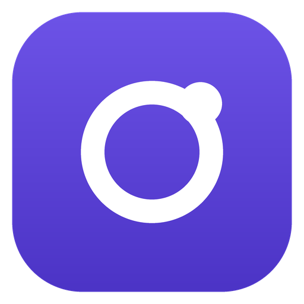
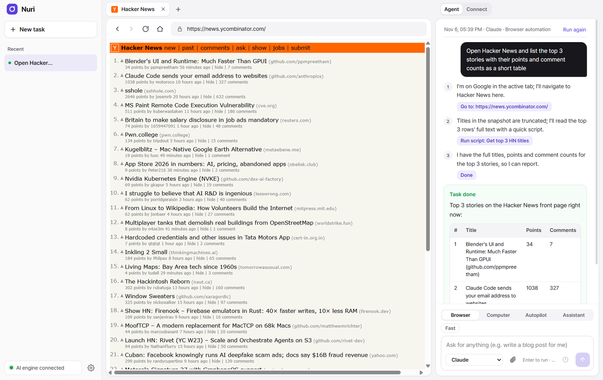
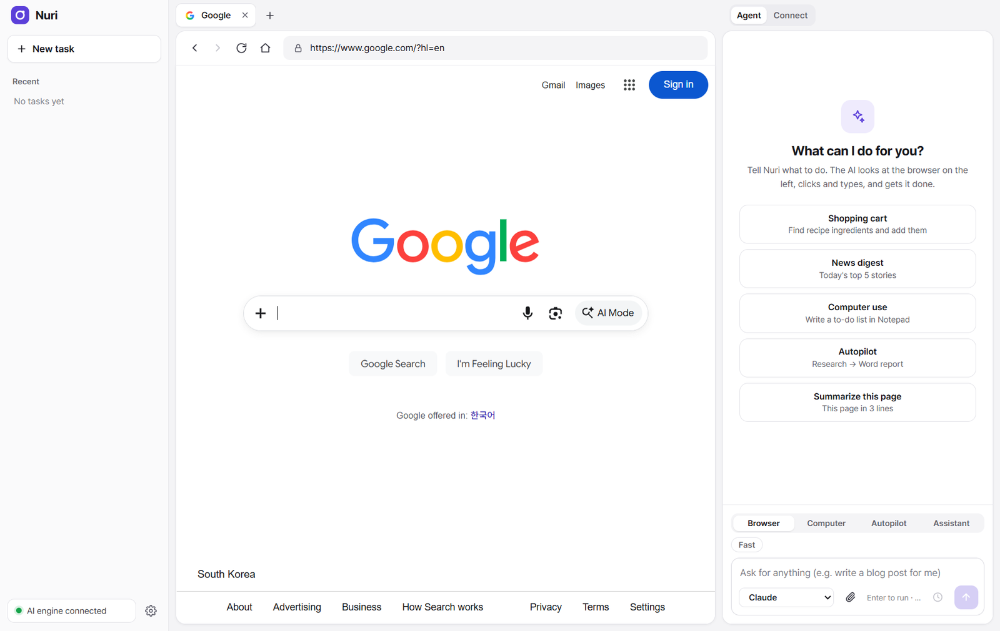
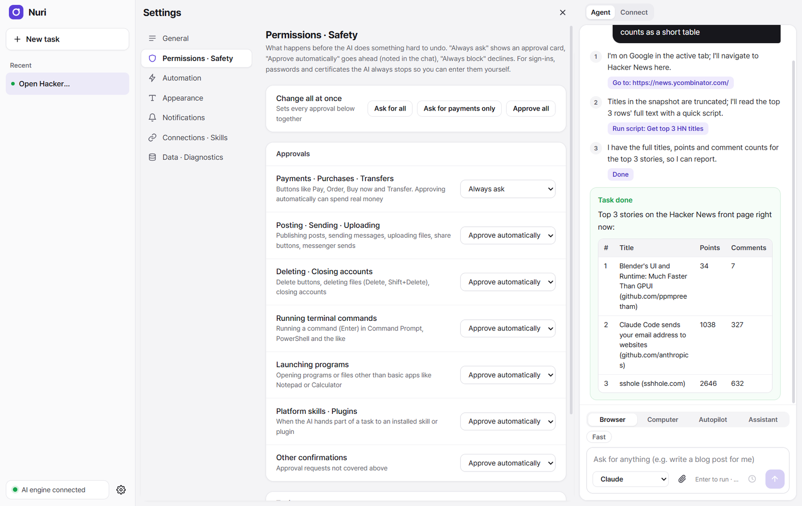
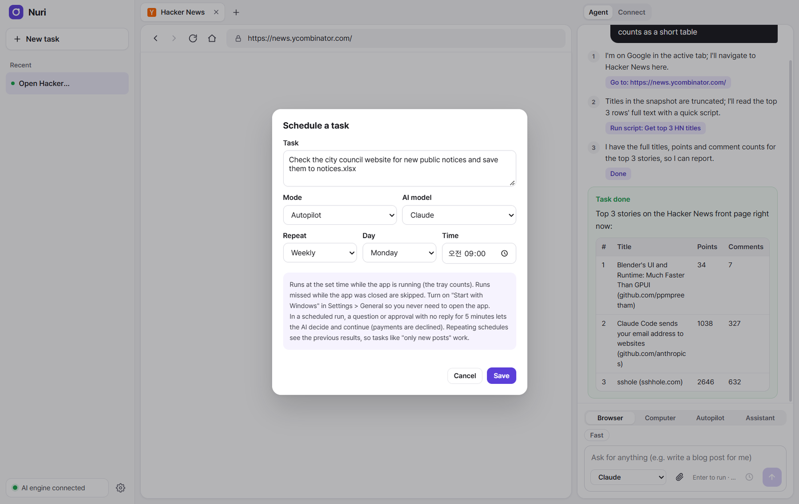
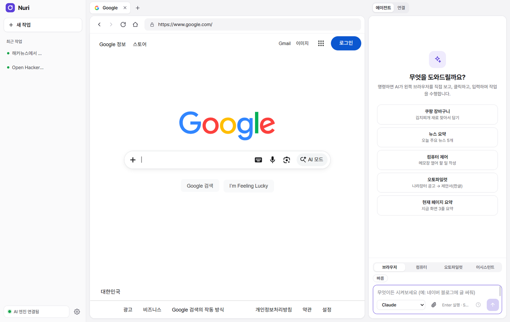

<div align="center">



# Nuri

**A desktop AI browser that does the work for you.**<br />
Tell it what you need. Nuri opens the pages, clicks, types, fills in forms, runs your Windows apps and writes the documents, step by step, in front of you.

**English** · [한국어](README.ko.md)




</div>

## Why Nuri

- **It actually does the task.** Nuri is a real browser with an agent built in. The agent sees the page, decides the next step and acts, so you can watch it work and stop it at any time.
- **Your own AI subscription.** Nuri drives the official command-line tools you already pay for: Claude (Claude Code), GPT (Codex CLI) and Gemini (Antigravity CLI). It never uses pay-as-you-go API keys.
- **You stay in charge.** Payments, posting, sending, deleting and running programs can each be set to *always ask*, *approve automatically* or *always block*. Sign-ins, passwords and certificates are always left to you.
- **Runs on your PC.** Logins, cookies and results stay on your computer. The AI engine listens only on `127.0.0.1` and every request needs a local token.

## Features

| | |
|---|---|
| **Browser automation** | The agent reads an accessibility snapshot of the page (iframes included), clicks, types, selects, uploads files, reads PDF/HWP/DOCX/XLSX attachments and saves results as Excel, CSV or Markdown. For pages it cannot read, it looks at a screenshot. |
| **Sub-agents** | Independent research, such as comparing prices on several sites, is split among up to four sub-agents that work at the same time, each in its own tab. |
| **Scripts** | For bulk work (e.g. collecting 300 rows across pages) the agent writes a short Playwright script that runs in a locked-down process. |
| **Computer use** | Operates Windows programs (Excel, Notepad, file dialogs and more) in the background without taking over your mouse, or directly on screen when an app needs it. |
| **Autopilot** | Breaks a long goal into a plan, then runs the steps across the browser, the PC and document writing (Word / Hangul / PDF). |
| **Assistant mode** | Uses the skills, plugins and MCP connectors you installed for each AI platform. |
| **Schedules** | Run a task once, daily, on weekdays, weekly, monthly or every N minutes. Repeating tasks see the previous results, so "only new posts" works. Starts with Windows and runs from the tray. |
| **Google sign-in** | Sign in through a small Chromium window; your session is brought into the app. |
| **English and Korean** | The whole app, its notifications and the AI's replies follow the language you choose (Settings > Appearance). |

<table>
  <tr>
    <td width="50%"><br /><sub>Start screen with example tasks</sub></td>
    <td width="50%"><br /><sub>Permissions and safety: decide what needs your approval</sub></td>
  </tr>
  <tr>
    <td width="50%"><br /><sub>Schedule a task to run by itself</sub></td>
    <td width="50%"><br /><sub>The same app in Korean</sub></td>
  </tr>
</table>

## Getting started (Windows)

**You need:** Windows 10 or 11, [Node.js](https://nodejs.org) 22 or later, and at least one AI CLI signed in with a subscription:

| Model | CLI | Sign in |
|---|---|---|
| Claude | [Claude Code](https://docs.anthropic.com/en/docs/claude-code) | `claude` → log in with your Claude account |
| GPT | [Codex CLI](https://github.com/openai/codex) | `codex login` → ChatGPT account |
| Gemini | Antigravity CLI (`agy`) | sign in with your Google account |

The CLIs can be installed on Windows, or inside WSL2 (Ubuntu). Nuri uses Windows when all of them are there, otherwise WSL.

```bash
# 1. Desktop app dependencies (use Windows npm: Electron must be the Windows build)
cd apps/desktop
npm install

# 2. Chromium for the Google sign-in window (about 180 MB, not stored in git)
npm run get-chromium

# 3. Computer-use helper (built with the .NET compiler that ships with Windows)
native\build.cmd

# 4. AI engine (from the repository root)
cd ../..
npm install
npx tsc -b

# 5. Start
cd apps/desktop
npm start
```

**Installer:** `npm run dist` in `apps/desktop` creates `Nuri-Setup-<version>.exe` in `apps/desktop/release/`.

## How it works

```text
┌──────────────────────── Nuri (Electron) ────────────────────────┐
│  UI (sidebar · tabs · agent panel)                                │
│  Agent loop ── Playwright (CDP, 127.0.0.1) ──▶ built-in Chromium │
│      │      └─ desktop helper (UI Automation) ──▶ Windows apps   │
│      ▼                                                            │
│  AI engine (local server, 127.0.0.1 + token)                      │
│      └─▶ claude / codex / agy  (your subscription sign-ins)       │
└──────────────────────────────────────────────────────────────────┘
```

Each step, the agent sends the AI a compact view of the page (or a screenshot) and gets back one JSON action. Web page content is always treated as untrusted data: the AI is told never to follow instructions found in it, and risky actions go through the approval policy before they run.

## Privacy and security

- Logins, cookies, the Google sign-in profile and the engine token are kept in `%APPDATA%\Nuri` (and `.anb-data/` when run from source). Nothing is sent anywhere except to the AI CLIs you signed in to.
- The engine binds to `127.0.0.1`, checks `Host` and `Origin`, and requires a per-install token on every request.
- Tabs deny camera, microphone and location requests, and block `file:` and `javascript:` navigation.
- Scripts written by the AI run in a separate process with Node's permission model: no access to your files beyond its own work folder.
- API-key environment variables are removed before the CLIs start, so usage always goes to your subscription.

## Project layout

```text
apps/desktop/          Electron app: UI, agent, browser and desktop automation, scheduler
  src/agent/           browser agent (prompt, decisions, sub-agents, tools)
  src/automation/      Playwright bridge, page snapshots, actions, scripts
  src/desktop/         computer use (Windows helper, background sessions)
  src/workflow/        Autopilot planner and runner
  ui/                  interface (HTML/CSS/JS) and translations (ui/locales)
packages/
  anb-orchestrator/    local AI engine server (LLM sessions, accounts, security)
  anb-core/            shared types, approval policy, redaction
  anb-mcp-server/      browser tool definitions
  anb-provider-agy/    Antigravity CLI adapter
tests/                 engine unit and integration tests
```

Run all tests with `npm test` from the repository root.

## Privacy and terms

Nuri collects nothing: there is no server, analytics or telemetry. What the app stores on your PC and what it sends to the AI provider you choose is described in the [Privacy Policy](PRIVACY.md). Using Nuri means you are responsible for the actions it takes for you; see the [Terms of Use](TERMS.md).

## License

[MIT](LICENSE). Bundled fonts are under the SIL Open Font License 1.1 (see `apps/desktop/ui/fonts`).
